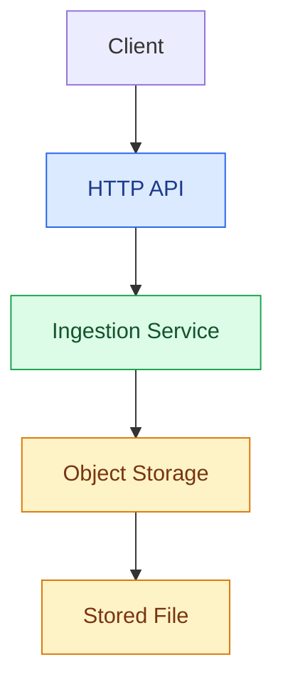

# ☁️ Cloud File Ingestion

**A Go-powered service for ingesting files into cloud object storage.**

Cloud File Ingestion is a backend engineering project focused on building a reliable, maintainable foundation for file ingestion using Go. It explores the design of a service that accepts file uploads through an API and stores them in object storage, with an architecture that can evolve toward asynchronous processing and large-scale data ingestion.

> **The goal:** Build more than a file upload endpoint. Build a foundation for a cloud-native ingestion system.

## 🎯 Why This Project?

File ingestion is easy to demonstrate and surprisingly interesting to engineer well.

As a system grows, new challenges emerge:

- How should files be validated and stored?
- How should API handlers, business logic, and storage infrastructure be separated?
- How can the service support different storage backends without coupling the application to one provider?
- How should ingestion failures, retries, and duplicate requests be handled?
- How can the system evolve toward asynchronous processing without turning the codebase into a tightly coupled monolith?

This project uses these questions as practical engineering exercises, with an emphasis on clean boundaries, explicit abstractions, and incremental development.

## 🏗️ Architecture

The initial architecture separates the API layer, ingestion logic, and storage integration.



### Core components

- **HTTP API** — Exposes endpoints for clients to submit files.
- **Ingestion Service** — Owns the application-level workflow and coordinates file ingestion.
- **Object Storage** — Handles persistent file storage through a storage integration.

The architecture is intentionally designed to keep responsibilities separate, making future changes easier to introduce and test.

## 🛠️ Technology Stack

| Technology | Purpose |
|---|---|
| Go | Backend implementation |
| HTTP API | File upload interface |
| S3-compatible object storage | File persistence |
| Docker | Local infrastructure and development |

The stack may evolve as the project grows.

## 🚀 Current Progress

The project is being developed incrementally, starting with a working upload flow and evolving toward a more complete ingestion service.

- [x] Initial Go project structure
- [x] HTTP API for file uploads
- [x] Initial upload flow to object storage
- [ ] Strengthen validation and error handling
- [ ] Add automated tests for ingestion workflows
- [ ] Introduce ingestion status tracking
- [ ] Explore asynchronous processing and retry strategies
- [ ] Add observability and operational metrics

*The checklist reflects the development roadmap and should be updated as features are implemented.*

## 🧪 Running Locally

### Prerequisites

- Go installed
- Docker installed
- An S3-compatible object storage service, such as MinIO

### 1. Start object storage

Run your local storage service and configure an appropriate bucket for uploads.

### 2. Configure the application

Set the storage endpoint, bucket name, and any required credentials using the configuration mechanism implemented by the application.

### 3. Start the API

From the project root, run:

```bash
go run ./cmd/api
```

The API should start using your configured local environment.

> Configuration variables, bucket initialization, and exact upload endpoint details will be documented here as the implementation stabilizes.

## 🗺️ Roadmap

The next steps focus on turning a working upload flow into a more robust ingestion system.

**Reliability**
- Consistent error handling and input validation
- Safe handling of failed and interrupted uploads
- Idempotency and duplicate-request handling

**Scalability**
- Asynchronous ingestion workflows
- Queue-based processing
- Retry policies and failure recovery

**Observability**
- Structured logging
- Metrics and health checks
- Tracing across ingestion stages

**Maintainability**
- Clear application and infrastructure boundaries
- Testable service interfaces
- Integration tests against local object storage

These are planned directions, not claims that the features are already available.

## 💡 Engineering Principles

This project is guided by a few principles:

- **Start simple.** Build a working vertical slice before introducing distributed infrastructure.
- **Separate responsibilities.** Keep transport, application logic, and storage concerns distinct.
- **Design for change.** Introduce abstractions where they provide real flexibility, not just for the sake of abstraction.
- **Make failure explicit.** Treat retries, partial failures, and duplicate requests as first-class engineering concerns.
- **Evolve deliberately.** Let actual requirements drive complexity.

## 🤝 Contributions & Feedback

Suggestions, architectural discussions, and constructive feedback are welcome.

If you're interested in Go backend development, cloud storage, or data ingestion architecture, feel free to explore the code and share your thoughts.

---

**Built with Go, one engineering decision at a time.**